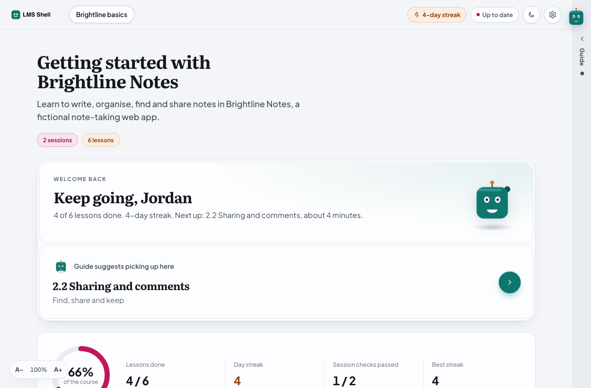
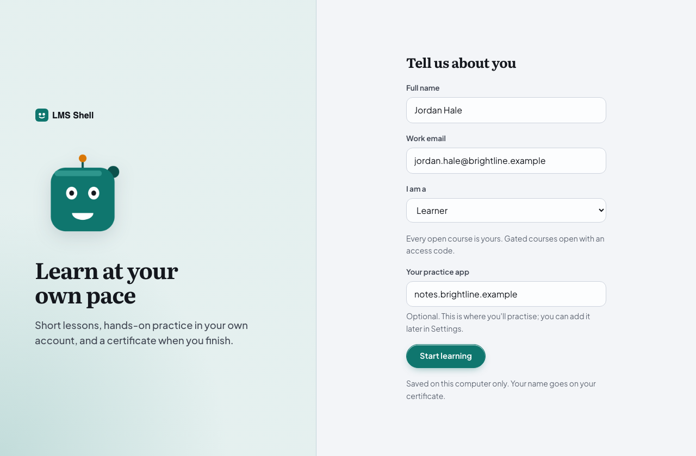
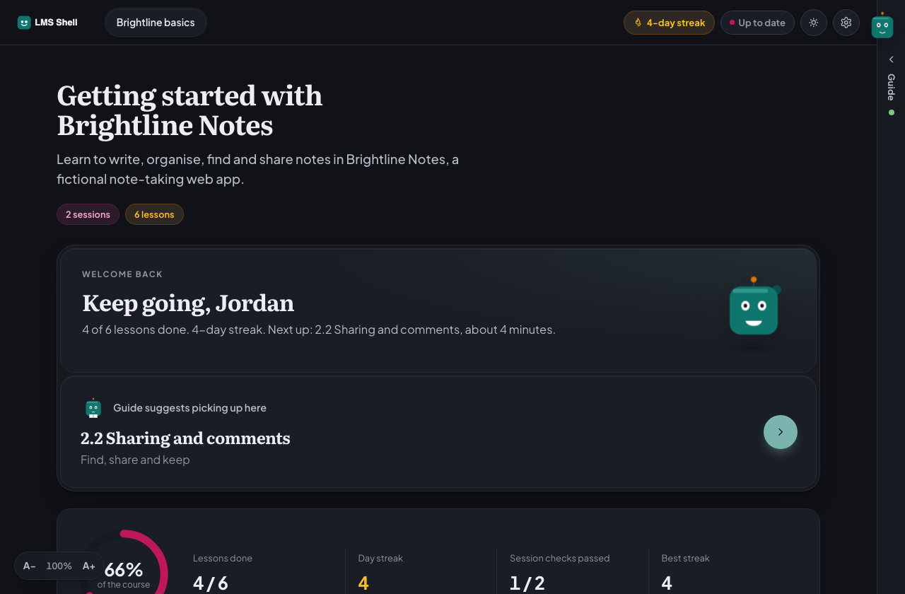
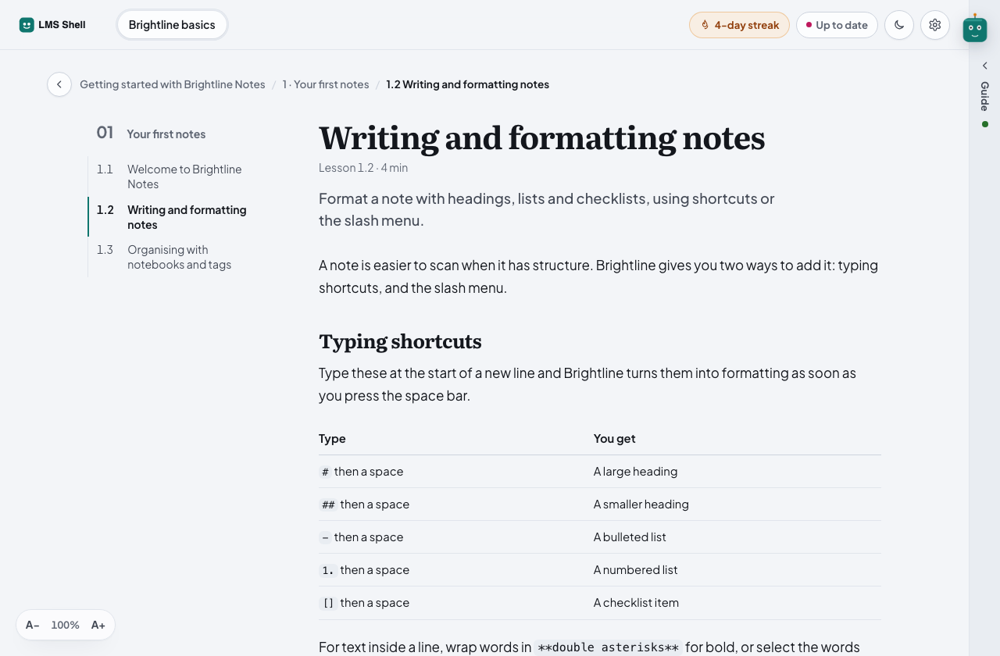
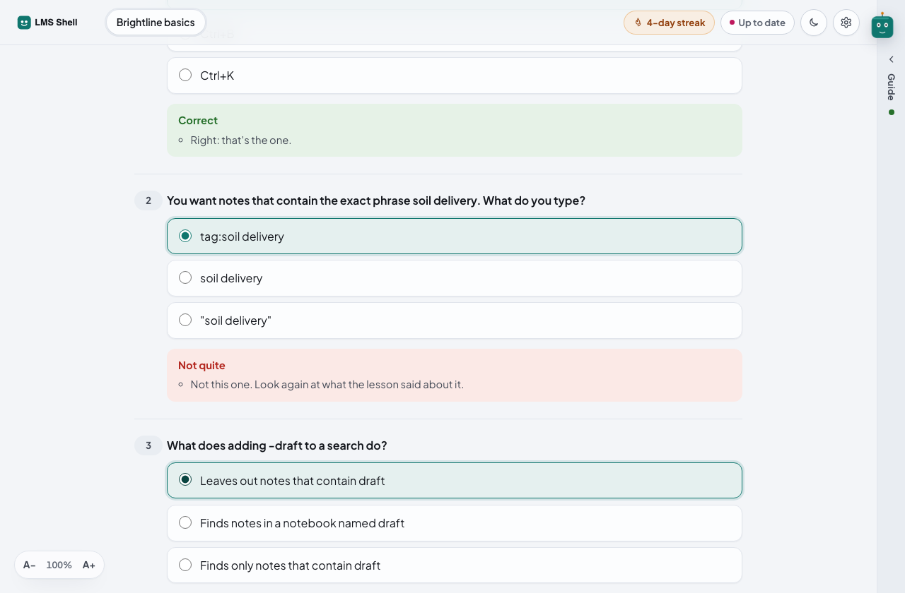
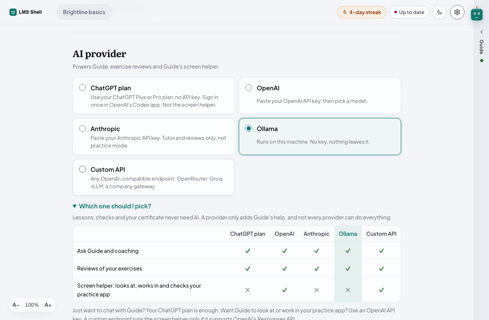
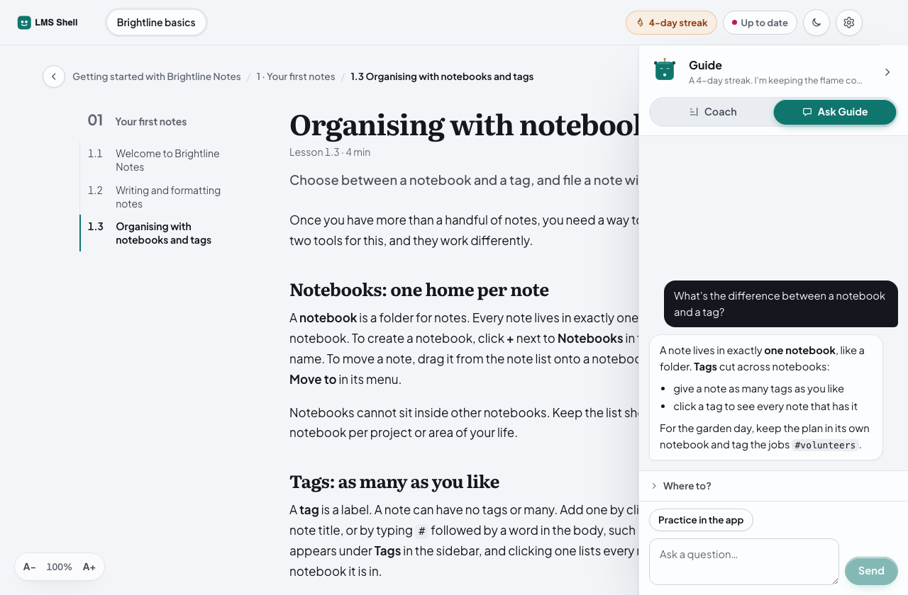

# LMS Shell

A desktop learning app you can fork and make your own. Courses with short lessons, quick checks, session checks, a final assessment and a certificate; progress, streaks and an activity grid; an AI coach that helps without giving away answers; a practice pane that opens any web app beside the lesson; and a friendly companion that explains the interface. Everything a learner does stays on their computer.

It ships with one small fictional course, **Getting started with Brightline Notes**, so you can see every part working before you write your own.

Built with [Tauri 2](https://tauri.app) and [Leptos](https://leptos.dev): Rust end to end, a native window around a WebAssembly UI, and a small shared crate for the types that cross between them. MIT licensed.



| | |
|---|---|
|  |  |
|  |  |
|  |  |

## Contents

- [What's in the box](#whats-in-the-box)
- [Quick start](#quick-start)
- [Rebrand in 5 steps](#rebrand-in-5-steps)
- [Add a course](#add-a-course)
- [Optional features](#optional-features)
- [Tests and checks](#tests-and-checks)
- [Project layout](#project-layout)
- [Licence](#licence)

## What's in the box

**Course engine**
- Courses, sessions and lessons written in YAML (`content/courses/`), with a validator.
- Quick checks after each lesson, with option shuffling that stays stable between launches.
- One session check per session and a final assessment, graded by the app against a pass mark. Retries are unlimited and the best score counts.
- A certificate once every check and the final are passed, printable to PDF.
- Progress, a daily streak, an activity grid and a "What's new" sheet after each update.
- A first-run course tour player with a placeholder slot (no video ships; see [docs/course-tour.md](docs/course-tour.md)).
- Onboarding (name, work email, role) with configurable roles, optional disposable-email and DNS checks, and access codes for gated courses.

**The companion** (called "Guide" out of the box)
- A tab on the right edge and a side pane with **Ask** (straight answers) and **Coach** (one stage at a time, with a hint ladder).
- Hover help for every control, short tooltips, coach marks for new learners, nudges when someone looks stuck, and a mood on the progress card.
- Placeholder geometric art you swap by replacing one folder.

**AI, optional**
- Providers: OpenAI, Anthropic, Ollama (local), any OpenAI-compatible endpoint, and a ChatGPT plan through OpenAI's Codex CLI.
- A "Which one should I pick?" table in Settings, a daily request limit, and chat safety rules: no quiz answers, no credentials.
- Lessons, checks and certificates never need AI.

**Practice pane, optional**
- Any https web app opens beside the lesson, with a toolbar, tabs, sign-in popups that work, and no orphaned windows.
- An optional screen helper (Look, Do it for me, Check my build) with an action guard that blocks destructive actions and asks before writes. See [SECURITY.md](SECURITY.md).

**Settings**: profile, access code, light and dark themes, text size, companion mode, AI provider, practice app, the companion's activity log, and Start over.

## Quick start

You need Rust (stable), the `wasm32-unknown-unknown` target, [Trunk](https://trunkrs.dev) and the Tauri CLI. Python 3 with PyYAML runs the content validator.

```bash
rustup target add wasm32-unknown-unknown
cargo install trunk tauri-cli --locked
pip install pyyaml

git clone <your fork> lms-shell && cd lms-shell
cd src-tauri
LMS_CONTENT_DIR="$PWD/../content" cargo tauri dev
```

The first launch opens onboarding. Use any name and a work email; pick **Learner** to start.

To build an app bundle:

```bash
cd src-tauri
cargo tauri build --debug --bundles app      # macOS .app in target/debug/bundle/macos/
cargo tauri build                            # release installers for this platform
```

## Rebrand in 5 steps

1. **Names.** Open `shared/src/brand.rs` and change `app_name!()`, `companion_name!()` and `TAGLINE`. Change `productName`, `identifier` and the window `title` in `src-tauri/tauri.conf.json`, and the `<title>` in `ui/index.html`.
2. **Colour.** Change `--brand` at the top of `ui/style.css`. The accent, soft fills and the dark theme's accent all derive from it. The four session colours (`--p0` to `--p3`) sit just below it.
3. **Art.** Replace the files in `ui/assets/mascot/` (one PNG per pose, same names, 512 by 512 with transparency), `ui/assets/icon.png` and `ui/assets/logo.svg` / `logo-white.svg`. Or edit `tools/make-placeholder-art.py` and run it. Then put a 1024 px icon at `src-tauri/app-icon.png` and run `cargo tauri icon app-icon.png` in `src-tauri/`.
4. **Roles and rules.** In `shared/src/brand.rs`: role labels and hints (`ROLES`), which roles are offered the access-code form, an optional staff email domain, the email checks, the practice app's allowed host suffix, and the prefix "Read more" links must use.
5. **Access codes.** Generate your own signing key and put its public key in `src-tauri/src/access.rs` (see [Access codes](#access-codes)). The shipped key is a placeholder whose private half was thrown away, so until you do this no code opens a gated course.

Then run the tests (`cargo test --workspace`) and the validator.

## Add a course

1. Copy `content/courses/brightline-basics/` to `content/courses/<your-course-id>/`.
2. Edit `course.yaml`: the id (it must match the folder), title, summary and the `sessions:` list. Each session names its lessons, one check and one exercise.
3. Write the lessons, checks, exercises and `assessment/final.yaml`. The schema, with every key, is in [content/SCHEMA.md](content/SCHEMA.md).
4. Run `python3 tools/validate.py` until it prints `OK`.
5. Run the app with `LMS_CONTENT_DIR` pointing at `content/` and walk through it.

Set `gated: true` in `course.yaml` to put a course behind an access code. Lesson videos are optional: put them under the course's `videos/` folder, or use an `https://` URL. More in [docs/authoring-content.md](docs/authoring-content.md).

## Optional features

### AI

Nothing to configure in code. Learners pick a provider in **Settings, AI provider**, paste a key (stored in the system keychain) and press **Save and test**. The table under **Which one should I pick?** shows what each provider can do:

| | ChatGPT plan | OpenAI API key | Ollama (local) | Anthropic key | Custom endpoint |
|---|---|---|---|---|---|
| Ask and coaching | Yes | Yes | Yes | Yes | Yes |
| Exercise reviews | Yes | Yes | Yes | Yes | Yes |
| Screen helper (Look, Do it for me, Check) | No | Yes | No | No | If it supports OpenAI's Responses API |

Ollama keeps everything on the learner's computer. The ChatGPT plan works through OpenAI's Codex CLI on desktop (`codex login`, then Sign in with ChatGPT). The daily request limit defaults to 300 per computer and can be changed in Settings. How prompts are built and guarded: [docs/ai-safety.md](docs/ai-safety.md).

### Practice pane

Learners enter their practice app's address in onboarding or **Settings, Practice app**, plus an optional Development (staging) address that opens from **+** in the pane's tabs. Any https address works by default. To lock it to your product, set `PRACTICE_HOST_SUFFIX` in `shared/src/brand.rs`, for example `Some("example.com")`.

The screen helper is part of the pane and needs an OpenAI-compatible Responses API. Add your app's own destructive labels and admin paths to [content/guard.yaml](content/guard.yaml), and read [SECURITY.md](SECURITY.md) before you turn learners loose on anything real.

### Access codes

Gated courses open with a per-person access code (an Ed25519 signature with an expiry) or an optional shared login. Codes are made offline:

```bash
node tools/access-code.mjs keygen                 # once: creates ~/.config/lms-shell/access-signing.pem
                                                  # and prints the PUBLIC_KEY to paste into src-tauri/src/access.rs
node tools/access-code.mjs casey.mercer --days 90 # prints a username and code to send to one person
sh tools/hash-login.sh                            # optional: prints SHARED_SALT and SHARED_KEY for a shared login
```

The shared login ships all zero, which means off. Full details: [docs/access.md](docs/access.md).

### Updates

The Tauri updater is wired in but off: no endpoint, no keys. To turn it on, set `UPDATER_ENABLED` in `shared/src/brand.rs`, add `plugins.updater` (your public key and endpoint) to `src-tauri/tauri.conf.json`, and publish signed releases. Step by step: [docs/updates.md](docs/updates.md). `tools/release.sh` is a template for publishing to GitHub releases.

## Tests and checks

| Command | What it covers |
|---|---|
| `cargo test --workspace` | Grading, content loading, access codes, the action guard, prompts, profile rules, nudge rules, layout maths |
| `cargo check -p ui --target wasm32-unknown-unknown` | The UI builds for the browser target |
| `python3 tools/validate.py` | The course content against the schema |
| `python3 tools/test_validate.py` | The validator's own tests |
| `sh tools/ui-check/run.sh` | The real UI in Chromium with the backend stubbed: companion, hover help, chat, and the executor on fixture pages (run `npm install` in `tools/ui-check/` once) |
| `sh tools/ai-gate.sh` | The AI release gate: the Rust tests plus the browser checks |

CI (`.github/workflows/ci.yml`) runs the Rust tests, the wasm check and the validator.

## Project layout

| Folder | What lives there |
|---|---|
| `src-tauri/` | The Tauri backend: commands, content loader, grading, SQLite, AI providers, practice pane, screen helper, action guard |
| `ui/` | The Leptos UI, built by Trunk; styles in `style.css` and `sidekick.css`; assets in `assets/` |
| `shared/` | Types and pure logic used by both sides, and `brand.rs`, the rebranding file |
| `content/` | Courses, the companion's nudges and hover help, the guard's word lists, What's new |
| `tools/` | Validator, access-code and shared-login tools, placeholder art, browser checks, release template |
| `docs/` | Architecture, authoring, access, AI safety, updates, course tour |

Start with [docs/architecture.md](docs/architecture.md).

## Licence

MIT, see [LICENSE](LICENSE). The fonts in `ui/assets/fonts/` (Literata and Plus Jakarta Sans) are under the SIL Open Font Licence, see `ui/assets/fonts/OFL.txt`. The disposable-email list in `shared/data/` is CC0 (see `shared/data/README.md`).
